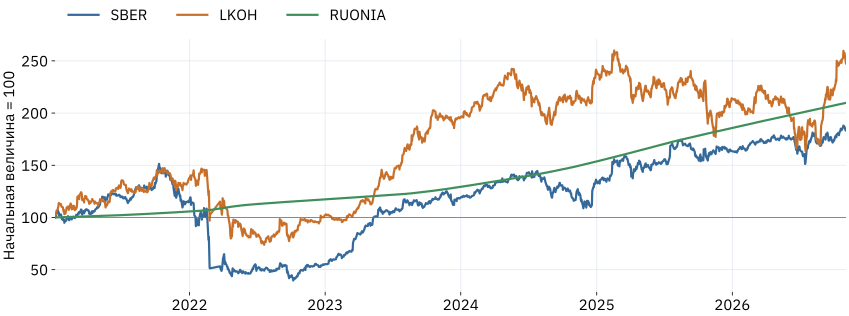

## Два вложения: какое выберете?

В начале периода у каждого было **100 условных единиц**.

::: {.columns}
::: {.column width="48%"}
### Вложение А

::: {.big}
184,2
:::

в конце периода
:::
::: {.column width="48%"}
### Вложение Б

::: {.big}
247,6
:::

в конце периода
:::
:::

::: {.prompt}
Какой информации вам не хватает для выбора?
:::

::: {.source}
Источник: Московская биржа, moexutils · 04.01.2021–03.11.2026. До налогов и издержек.
:::

## Теперь видим весь путь

{.chart}

::: {.prompt}
В какой момент было бы труднее всего продолжать держать вложение?
:::

::: {.source}
Дневные скорректированные ряды. Во время перерыва торгов в 2022 г. линия соединяет доступные наблюдения.
:::

## За буквами стоят реальные акции

| Вложение | Тикер | Что использовано |
|---|---|---|
| А | SBER | Ряд с поправками на сплиты и дивиденды |
| Б | LKOH | Ряд с теми же видами поправок |

Чтобы сравнить траектории, приводим их к одной начальной величине:

**Нормированное значение = 100 × значение в дату / значение в первую дату.**

::: {.small}
Это исторический пример двух заранее выбранных акций. Он не показывает, какую бумагу следовало бы выбрать заранее или покупать сейчас.
:::

::: {.source}
Источник: Московская биржа, moexutils. Ряды скорректированы на сплиты и дивиденды.
:::

## Итоговый рост не показывает глубину падения

{.chart}

**Просадка** – снижение от максимального значения, достигнутого к этой дате.

::: {.source}
Расчёт по доступным дневным наблюдениям, 04.01.2021–03.11.2026. Внутридневные падения могут быть глубже.
:::

## Цена акции и результат с дивидендами различаются

{.chart}

Чтобы сравнение было честным, выплаты обеих бумаг нужно учитывать одинаково.

::: {.source}
SBER, 04.01.2021–03.11.2026. adj_close – аналитическая корректировка; это приближение реинвестирования до налогов и издержек, а не цена сделки.
:::

## Сравним с денежным рынком

{.chart}

Расчётный ориентир RUONIA: 100 → **209,8**, 13,6% в год. SBER – 11,0%, LKOH – 16,8% в год.

::: {.source}
Расчёт по ставкам [RUONIA Банка России](https://cbr.ru/hd_base/ruonia/method/): капитализация по датам ставок, простые проценты между ними, база 365/366. Это ориентир, а не доступный вклад или гарантия дохода. 04.01.2021–03.11.2026, до налогов и издержек.
:::
