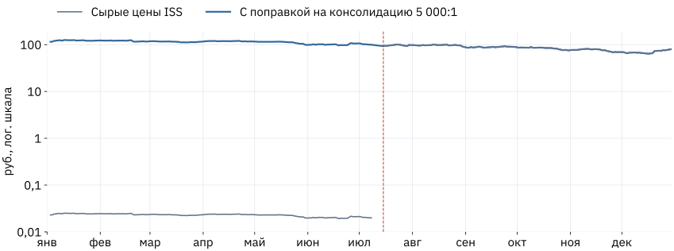
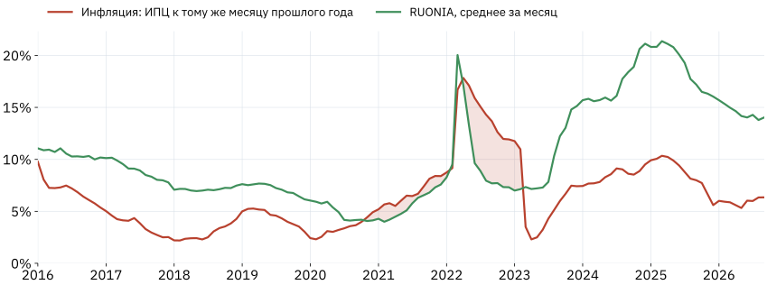

## Финансовые данные: четыре группы

| Группа | Примеры | Частота | Когда становится известно |
|---|---|---|---|
| Рыночные | цены сделок, объёмы, котировки | от микросекунд до дня | сразу после торгов |
| Фундаментальные | выручка, прибыль, долг, дивиденды | квартал, год | через месяцы: отчётность за 2025 г. – весной 2026 г. |
| Макроэкономические и ставки | ключевая ставка, RUONIA, инфляция, курс рубля | день, месяц, квартал | ставки и курс – сразу, инфляция – в следующем месяце |
| Альтернативные | новости, поисковые запросы, платежи | разная | разная |

::: {.prompt}
В таблице число записано под датой периода, к которому оно относится. Когда о нём узнал инвестор?
:::

## Где брать данные по российскому рынку

| Что нужно | Источник | Доступ |
|---|---|---|
| Торги акциями, облигациями, индексы | Московская биржа: ISS, iss.moex.com | бесплатно, без ключа |
| Ключевая ставка, RUONIA, курсы валют | Банк России, cbr.ru | бесплатно |
| Инфляция, производство, доходы, регионы, бюджет | Росстат, ЕМИСС, Казначейство → **rustata.ru** | бесплатная регистрация, токен |
| Отчётность компаний | e-disclosure.ru, bo.nalog.ru, набор RFSD | бесплатно |
| Дивиденды, сплиты, переименования | сообщения эмитентов и биржи | собирать и проверять самим |
| Зарубежные рынки и макро | FRED, SEC EDGAR, Yahoo Finance | бесплатно; по российским бумагам после 2022 г. ненадёжно |

::: {.source}
Глава 2 книги: разделы «Московская биржа и ISS», «Данные Банка России», «Российская экономическая статистика: rustata».
:::

## Как устроена Московская биржа

::: {.columns}
::: {.column width="44%"}
**Рынки:** фондовый (акции, облигации, фонды), валютный, денежный (РЕПО), срочный.

**Режимы торгов** (boards): одна акция торгуется в нескольких. Основной для акций – **TQBR**: там большая часть оборота, по нему считаются индексы.

Неполные лоты, крупные пакеты, РЕПО – другие цены. Режимы не смешиваем.
:::
::: {.column width="52%"}
Адрес запроса повторяет иерархию биржи:

```text
iss.moex.com/iss/history/engines/stock
  /markets/shares/boards/TQBR
  /securities/SBER.json
  ?from=2023-01-01&till=2023-12-31
```

движок `stock` → рынок `shares` → режим `TQBR` → бумага `SBER`

Ответ – набор таблиц: у каждой список столбцов `columns` и строки `data`.
:::
:::

## Ловушка постраничной выдачи

::: {.columns}
::: {.column width="46%"}
В 2023 г. было **254** торговых дней. Первый запрос за год возвращает **100** строк.

Таблица `history.cursor`: `INDEX` – первая строка страницы, `TOTAL` – всего строк, `PAGESIZE` – размер страницы.

Код работает без ошибок, данные выглядят правдоподобно, но это первые 100 дней.
:::
::: {.column width="50%"}
```python
period = {"from": "2023-01-01", "till": "2023-12-31"}
pages, first = [], 0
while True:
    resp = iss_get(path, **period, start=first)
    pages.append(resp["history"])
    total = resp["history.cursor"]["TOTAL"][0]
    first += len(resp["history"])
    if len(resp["history"]) == 0 or first >= total:
        break
hist = pd.concat(pages, ignore_index=True)
```
:::
:::

::: {.prompt}
Проверка: около 250 строк в год, даты не повторяются. С этого стоит начинать проверку кода, написанного ИИ-ассистентом.
:::

## Паспорт данных

Без паспорта результат нельзя воспроизвести: биржа уточняет историю, выходят новые дивиденды. Пример – SBER в снимке занятия.

| Поле | SBER |
|---|---|
| Источник и режим | ISS Московской биржи, TQBR; дивиденды – закрытияреестров.рф |
| Дата выгрузки | 17.11.2026 |
| Первая и последняя дата | 05.01.2015 – 16.11.2026 |
| Дней с ценой · пропусков внутри ряда | 2 984 · 0 |
| Самый длинный разрыв | 27 дн.: 25.02.2022 – 24.03.2022 |
| Поправки | `adj_close` – сплиты и дивиденды, `close` – только сплиты |

::: {.prompt}
Самый длинный разрыв приходится на остановку торгов в 2022 г. Что сделать с доходностью через этот разрыв?
:::

## Консолидация: ВТБ, июль 2024 г.

{.chart}

::: {.small}
Последняя цена до события – 0,01993 руб. (08.07.2024), первая после – 92,95 руб. (15.07.2024): по сырым ценам рост в 4 664 раз. С поправкой 5 000:1 – 99,65 руб. и −6,7%. Между датами 4 торговых дня бумага не торговалась.
:::

## Дивиденды: экс-дивидендная дата

::: {.columns}
::: {.column width="50%"}
**Дата закрытия реестра** – кто в реестре, тот получит дивиденд.

**Экс-дивидендная дата** – первый день торгов без права на дивиденд: цена открывается ниже примерно на дивиденд.

- T+1 (с 31.07.2023): экс-дата = дата закрытия реестра.
- T+2 (раньше): экс-дата – торговый день перед закрытием реестра.
:::
::: {.column width="46%"}
**Корректировка прошлых цен**

k = 1 − D / P<sub>t−1</sub>

D – дивиденд, P<sub>t−1</sub> – закрытие накануне экс-даты. Все цены до экс-даты умножаются на k.

SBER, реестр 18.07.2025, дивиденд 34,84 руб.: по `close` – падение, по `adj_close` – обычный день.
:::
:::

::: {.prompt}
Скорректированные цены прошлых лет меняются после каждой новой выплаты. Что это значит для сохранённой выгрузки?
:::

## Переименования и ошибка выжившего

::: {.columns}
::: {.column width="40%"}
**Одна компания – несколько тикеров**

| Тикер | С даты |
|---|---|
| MAIL → VKCO | 14.12.2021 |
| YNDX → YDEX | 24.07.2024 |
| HHRU → HEAD | 26.09.2024 |
| TCSG → T | 28.11.2024 |

Поиск по новому тикеру теряет историю до переименования.
:::
::: {.column width="56%"}
**Ошибка выжившего:** выбираем акции по сегодняшнему списку и теряем ушедшие с биржи.

В данных книги за 2016–2025 гг. средняя годовая доходность по всем бумагам – 16,7%, только по «выжившим» – 19,2%: **+2,5 п.п. в год**. Ушли 17 бумаг из 92.

В снимке занятия у PIKK последняя цена – 15.10.2026. Если бумагу снимут с торгов, выборка «по сегодняшнему списку» её потеряет.
:::
:::

## Проверка качества: что смотреть всегда

1. **Полнота:** число строк по годам, повторяющиеся даты, сверка с календарём индекса.
2. **Режим и источник:** TQBR, одна и та же бумага во всём периоде, учтены переименования.
3. **Скачки больше 30–50% за день:** сплит без поправки – ошибка, 24.02.2022 – реальное событие.
4. **Дивиденды:** какой столбец – `close` или `adj_close`.
5. **Пропуски:** дни без сделок и остановки торгов не заполняются нулевой доходностью.
6. **Момент доступности:** не использовать число раньше, чем о нём узнали.

::: {.prompt}
Выбросы не удаляем по порогу: вместе с ними из данных исчезают кризисы, то есть сам риск.
:::

## Макроданные: зачем они инвестору

::: {.columns}
::: {.column width="32%"}
### Инфляция

Номинальный рост денег ничего не говорит о покупательной способности.

**Реальная доходность:** (1 + R) / (1 + π) − 1
:::
::: {.column width="32%"}
### Курс рубля

Для инвестора, который считает в долларах или покупает импорт, результат другой.

Доходность в долларах: R<sub>руб</sub> с поправкой на изменение курса.
:::
::: {.column width="32%"}
### Ставки

Безрисковая альтернатива акциям: ключевая ставка, RUONIA.

От неё считаем премию за риск и коэффициент Шарпа.
:::
:::

::: {.prompt}
Где взять инфляцию за 10 лет одним рядом, с датой публикации каждого значения?
:::

## rustata: российская статистика в одном месте

::: {.columns}
::: {.column width="50%"}
**rustata.ru** – проект автора курса.

- 134 наборов: Росстат, Банк России, Казначейство, ФНС; более 6 млн рядов.
- Единые справочники территорий, товаров и единиц.
- **История публикаций:** дата, когда значение стало известно (`as_of`).
- Сайт: поиск словами, графики, регионы, CSV.
- API по токену, регистрация бесплатная: rustata.ru/api.
:::
::: {.column width="46%"}
**Чем неудобны первоисточники**

- Данные разбросаны по ЕМИСС (fedstat.ru) и бюллетеням Excel.
- Показатели – номера вроде «31074», названия рядов меняются от выгрузки к выгрузке.
- Статистика пересматривается: в свежей выгрузке – исправленное значение, а не известное в момент публикации.
:::
:::

## Инфляция и денежный рынок

{.chart}

::: {.small}
Пик инфляции – 17,8% (апрель 2022 г.). Заливка – месяцы, когда RUONIA была ниже инфляции: реальная ставка денежного рынка отрицательна (11.2020–01.2022, 04.2022–02.2023).
:::

::: {.source}
ИПЦ – Росстат (ЕМИСС, показатель 31074), через rustata.ru; RUONIA – Банк России. Последний месяц ИПЦ – сентябрь 2026.
:::

## Номинальная, реальная и долларовая доходность

05.01.2015–30.09.2026, среднегодовой рост (CAGR)

| | Номинальная, руб. | Реальная, с поправкой на инфляцию | В долларах |
|---|---|---|---|
| IMOEX – только цены | 4,0% | −2,7% | 0,4% |
| MCFTR – с дивидендами | 11,3% | 4,2% | 7,5% |
| Денежный рынок (RUONIA) | 11,2% | 4,0% | 7,4% |

::: {.small}
Период заканчивается последним месяцем с данными по инфляции, поэтому номинальные числа немного отличаются от слайдов дальше. Цены за период выросли в 2,18 раза (6,9% в год). Курс доллара Банка России: 56,24 руб. в начале периода, 84,43 руб. в конце, максимум – 120,38 руб. (11.03.2022).
:::

::: {.prompt}
Ценовой индекс IMOEX в реальном выражении отрицателен. Что это говорит о роли дивидендов?
:::

## Инфляция из rustata: код

```python
import io, requests, pandas as pd
from qf import secrets                       # токен из файла .env, не из кода

API = "https://rustata.ru/api/v1"
headers = {"Authorization": f"Bearer {secrets.get('RUSTATA_TOKEN')}"}
resp = requests.get(f"{API}/data", headers=headers, timeout=60, params={
    "dataset": "fedstat/indicator_31074",    # индексы потребительских цен
    "geo": "country", "class": "1",          # Россия, все товары и услуги
    "measure": "MOM", "start": "2015-01",    # к предыдущему месяцу
    "format": "csv"})
cpi = pd.read_csv(io.StringIO(resp.text), sep=";", parse_dates=["period"])
price_level = (cpi.set_index("period")["value"] / 100).cumprod()
```

::: {.small}
Код продукта («1» – все товары и услуги) берётся из справочника набора `/reference/codes`, а не по памяти: в другом наборе тот же код означает другое. Токен – это пароль: его нельзя писать в код, который попадёт в отчёт или репозиторий.
:::

## Когда число стало известно

::: {.columns}
::: {.column width="48%"}
**Дата периода и дата публикации – разные даты.**

- ИПЦ за месяц публикуется в следующем месяце и не пересматривается.
- Промышленное производство, ВВП, бюджет уточняются после первой публикации.
- Отчётность компаний выходит через месяцы после конца года.
:::
::: {.column width="48%"}
**Заглядывание в будущее** – использовать на дату t то, что стало известно позже.

rustata хранит дату публикации каждого значения: параметр `as_of` возвращает ряд в том виде, в каком его знали на эту дату.
:::
:::

::: {.prompt}
Модель прогнозирует доходность акций по инфляции за тот же месяц. Почему её результат на истории будет лучше, чем в реальной работе?
:::
