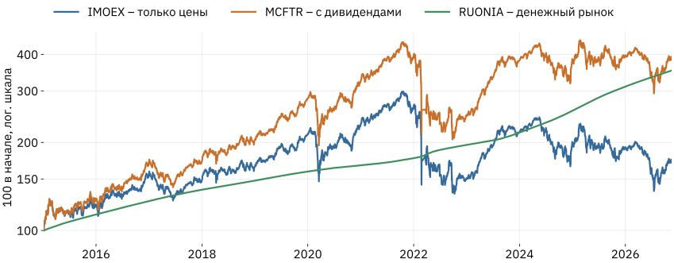
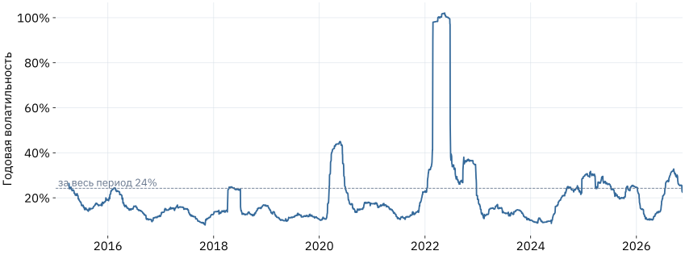
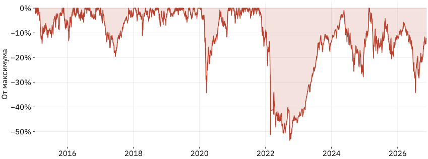
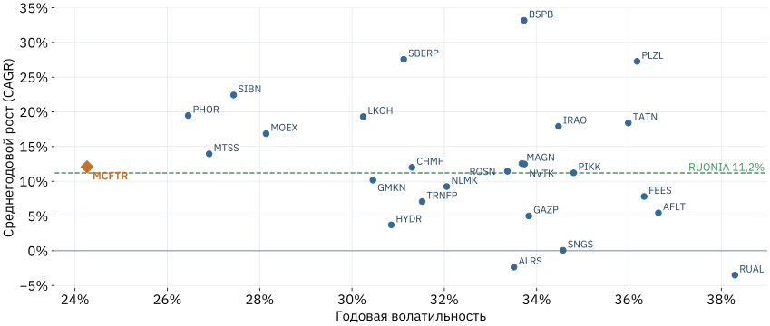

## Вложение на пике

20.10.2021 инвестор вложил 100 руб. в индекс полной доходности MCFTR.

::: {.columns}
::: {.column width="32%"}
### Худшая точка

::: {.big}
−53,5%
:::

26.09.2022
:::
::: {.column width="32%"}
### Возврат к 100 руб.

::: {.big}
40 мес.
:::

17.02.2025
:::
::: {.column width="32%"}
### Денежный рынок

::: {.big}
+52%
:::

за тот же срок
:::
:::

::: {.prompt}
Хорошее это было вложение? Какими числами вы бы ответили на этот вопрос?
:::

::: {.source}
Московская биржа, Банк России; расчёт по дневным закрытиям. До налогов и издержек.
:::

## Почему считаем доходности, а не цены

- Цена акции зависит от числа акций и ничего не говорит о выгоде вложения.
- Инвестора интересует, **на сколько процентов** изменились его деньги.
- Цены «уходят» со временем, их среднее зависит от периода. Доходности колеблются вокруг устойчивого уровня, их можно сравнивать.

**Простая доходность:** R = P<sub>t</sub> / P<sub>t−1</sub> − 1

**Логарифмическая:** r = ln(P<sub>t</sub> / P<sub>t−1</sub>) = ln(1 + R)

::: {.prompt}
Цена упала со 100 до 50 руб., затем выросла до 100. Чему равны простые доходности? А логарифмические?
:::

## Падение и рост не компенсируют друг друга

::: {.columns}
::: {.column width="32%"}
### MCFTR, 2022

::: {.big}
−37,3%
:::
:::
::: {.column width="32%"}
### MCFTR, 2023

::: {.big}
+53,8%
:::
:::
::: {.column width="32%"}
### За два года

::: {.big}
−3,5%
:::
:::
:::

Чтобы отыграть падение 2022 г., нужен был рост на **59%**.

::: {.prompt}
(1 − 0,373) × (1 + 0,538) − 1: за два года доходности перемножаются, а не складываются.
:::

::: {.source}
Индекс MCFTR на конец года, Московская биржа.
:::

## Какую доходность для чего брать

| | Простая R | Логарифмическая r |
|---|---|---|
| За несколько дней | ∏(1 + R) − 1 | Σ r – простая сумма |
| Портфель из активов | Σ w·R – взвешенная сумма | не складывается |
| Нижняя граница | −100% | −∞ |
| Где применяем | портфели, отчёты, интерпретация | модели рядов, агрегирование во времени |

::: {.prompt}
Складываем во времени – логарифмические, складываем по активам – простые.
:::

При малых изменениях ln(1 + R) ≈ R: для обычного дня разница в четвёртом знаке.

## Цена или скорректированная цена

В самостоятельной работе вы нашли разрыв: **18.07.2025** – экс-дивидендная дата SBER, дивиденд 34,84 руб.

::: {.columns}
::: {.column width="48%"}
### По close

::: {.big}
−5,5%
:::

327,05 → 309,00 руб.
:::
::: {.column width="48%"}
### По adj_close

::: {.big}
+5,7%
:::

учитывает выплату акционеру
:::
:::

::: {.small}
Цены до экс-даты умножаются на 1 − D/P. Корректировка убирает технический эффект выплаты, но не реальные новости: отмена ожидаемого дивиденда (GAZP, 30.06.2022) остаётся падением.
:::

## Без дивидендов рынок выглядит хуже, чем он есть

{.chart}

IMOEX: **4,7%** в год · MCFTR: **12,1%** · RUONIA: **11,2%**

::: {.source}
05.01.2015–16.11.2026. Бенчмарк для акций с дивидендами – MCFTR, не IMOEX. RUONIA – расчётный ориентир, не вклад.
:::

## Средняя доходность: какая?

Годовые доходности MCFTR за 2016–2025 гг.

| Среднее | Значение | На какой вопрос отвечает |
|---|---:|---|
| Арифметическое | 14,8% | Оценка доходности одного следующего года |
| Геометрическое (CAGR) | 11,9% | Как в среднем росли деньги инвестора |
| Волатильность годовых доходностей | 25,2% | |

Приближённо: геометрическое ≈ арифметическое − σ²/2. Чем выше волатильность, тем больше разрыв.

::: {.prompt}
Какое среднее вы увидите в рекламе инвестиционного продукта?
:::

## Волатильность

**Волатильность** – стандартное отклонение доходностей: насколько они обычно отклоняются от среднего.

Годовая = дневная × √252. Дневная волатильность IMOEX 1,53% → годовая **24,3%**.

::: {.columns}
::: {.column width="48%"}
### Почему корень

Если дневные доходности независимы, дисперсия за 252 дня в 252 раза больше дневной. Стандартное отклонение – в √252 ≈ 15,9 раза.
:::
::: {.column width="48%"}
### Другие частоты

Месячные данные: × √12.

Недельные: × √52.

Умножение на 252 – частая ошибка.
:::
:::

## Риск меняется во времени

{.chart}

::: {.prompt}
Большие движения следуют за большими: **кластеры волатильности**.
:::

::: {.source}
IMOEX, окно 63 торговых дня (квартал). Пик 2022 г. завышен: изменение за месяц паузы торгов попадает в один день.
:::

## Тяжёлые хвосты

::: {.columns}
::: {.column width="52%"}
Дни IMOEX с отклонением от среднего:

| Отклонение | Факт | Если бы нормальное |
|---|---:|---:|
| сильнее 2σ | 92 | 135,7 |
| сильнее 3σ | 23 | 8,1 |
| сильнее 4σ | 15 | 0,19 |
| сильнее 5σ | 9 | <0,01 |

Избыточный эксцесс: **175**, без 24.02.2022 – **18,5** (у нормального – 0).
:::
::: {.column width="44%"}
Пять худших дней IMOEX:

| Дата | Доходность |
|---|---:|
| 24.02.2022 | −33,3% |
| 21.02.2022 | −10,5% |
| 20.09.2022 | −8,8% |
| 09.04.2018 | −8,3% |
| 12.03.2020 | −8,3% |
:::
:::

::: {.source}
05.01.2015–16.11.2026, 2983 дневных доходностей. Модели с нормальным распределением недооценивают крупные потери.
:::

## Особенность данных: пауза 2022 г.

После 25.02.2022 торги акциями остановили, возобновили 24.03.2022.

- `diff()` и `pct_change()` посчитают изменение за месяц как доходность **одного дня**.
- В таблице с разными инструментами пропуски появятся в разные дни. `pct_change()` с заполнением пропусков вернёт **нулевую** доходность, как будто торги шли.

```python
ret = prices.pct_change(fill_method=None)       # пропуск остаётся пропуском
gap = prices.index.to_series().diff().dt.days   # проверка разрывов в датах
```

::: {.prompt}
В снимке занятия у MCFTR нет значения за 24.03.2022: биржа его не опубликовала. Это тоже нужно заметить.
:::

## Просадка

{.chart}

**Просадка** = цена / максимум к этой дате − 1. Максимальная у MCFTR: **−53,5%** (26.09.2022). Ниже прошлого максимума индекс был в 93% дней; сейчас – −13,4%.

## Ваши акции: риск и доходность

{.chart}

::: {.small}
Корреляция волатильности и роста по 25 акциям: **−0,30**. Обогнали MCFTR – 12 из 25, денежный рынок – 15 из 25. 05.01.2015–16.11.2026, по adj_close.
:::

## Доходность с поправкой на риск

**Коэффициент Шарпа** = средняя избыточная доходность / её волатильность.

Избыточная – сверх безрисковой ставки: в России берём денежный рынок (RUONIA).

| | За весь период | до 2022 г. | с 2022 г. |
|---|---:|---:|---:|
| MCFTR | 0,16 | 0,74 | −0,32 |
| IMOEX | −0,14 | 0,41 | −0,62 |

2024 г.: MCFTR **1,6%**, денежный рынок **18,8%** – и ни одного дня падения.

::: {.small}
Дневные доходности сверх RUONIA × √252, 05.01.2015–16.11.2026. Шарп не различает рост и падение и плохо видит редкие крупные потери – его дополняют просадкой.
:::
