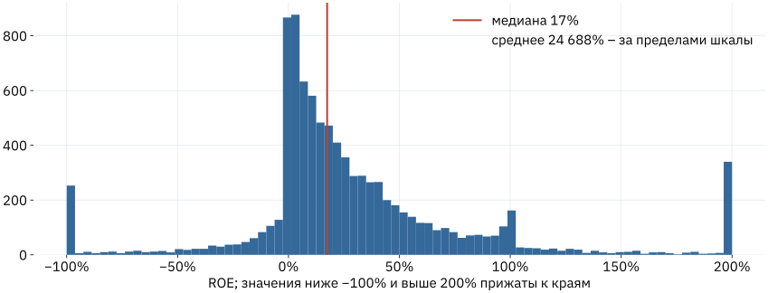
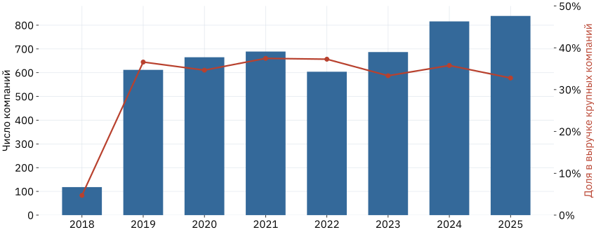
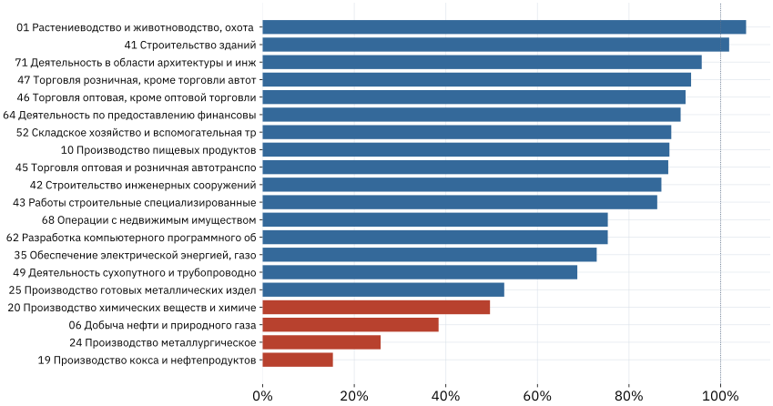

## Выручка «Магнита» – меньше миллиарда?

::: {.columns}
::: {.column width="32%"}
### ПАО «Магнит», выручка

::: {.big}
0,56 млрд
:::

2023 г.
:::
::: {.column width="32%"}
### ПАО «Магнит», прибыль

::: {.big}
98,3 млрд
:::

из них дивиденды дочерних компаний – 97,6 млрд
:::
::: {.column width="32%"}
### АО «Тандер», выручка

::: {.big}
2,31 трлн
:::

дочерняя компания: магазины сети
:::
:::

::: {.prompt}
Ошибка в данных? Как прибыль может быть в сто раз больше выручки?
:::

::: {.source}
RFSD, отчётность за 2023 г., млрд руб.
:::

## Отчётность юрлица, а не группы

- **ПАО «Магнит»** – холдинг: владеет другими компаниями, сам почти ничего не продаёт.
- Магазины принадлежат дочерней компании **АО «Тандер»**.
- Прибыль холдинга – дивиденды дочерних компаний: строка 2310 «Доходы от участия».
- В 2025 г. «Тандер» получил убыток (−22,5 млрд руб.) → дивидендов нет → прибыль «Магнита» – 5,4 млрд руб.

::: {.columns}
::: {.column width="48%"}
**РСБУ** – российские стандарты: отчётность **одного юрлица**. Это и есть RFSD.
:::
::: {.column width="48%"}
**МСФО** – международные стандарты: отчётность **всей группы**, сделки внутри группы исключены.
:::
:::

::: {.prompt}
Прежде чем анализировать компанию, выясните, какое юрлицо ведёт основной бизнес.
:::

## Откуда берётся отчётность

- Каждая организация раз в год сдаёт бухгалтерскую отчётность в налоговую (ФНС).
- С 2019 г. отчёты открыты в **ГИР БО**: [bo.nalog.gov.ru](https://bo.nalog.gov.ru/).
- Банки и страховщики отчитываются перед Банком России – в наборе их нет.
- **RFSD** – эти отчёты за 2011–2025 гг., собранные в одну очищенную таблицу. Делает Европейский университет в Санкт-Петербурге.

::: {.columns}
::: {.column width="32%"}
::: {.big}
3,1 млн
:::
организаций в 2025 г.
:::
::: {.column width="32%"}
::: {.big}
2,0 млн
:::
подали отчётность
:::
::: {.column width="32%"}
::: {.big}
1,5 млн
:::
с выручкой больше нуля
:::
:::

::: {.source}
RFSD v3 (Bondarkov, Ledenev, Skougarevskiy, 2025), лицензия CC BY 4.0, данные на Hugging Face.
:::

## Ваши акции: кто есть в RFSD?

25 эмитентов акций курса. Отчётность за 2025 г.:

| Отчётность | Эмитенты |
|---|---|
| Открыта: **8** | AFLT, GAZP, IRAO, LKOH, MTSS, NLMK, PHOR, TATN |
| Скрыта: **14** (в скобках – последний открытый год) | ALRS (2018), CHMF (2018), FEES (2023), GMKN (–), HYDR (2024), MAGN (2018), NVTK (2021), PIKK (2024), PLZL (–), ROSN (2018), RUAL (–), SIBN (2021), SNGS (2018), TRNFP (2018) |
| Нет в RFSD: банки и биржа | SBER, SBERP, BSPB, MOEX – отчитываются перед Банком России |

::: {.prompt}
Большинство «голубых фишек» по открытым данным не изучить. Что это значит для выводов об отрасли?
:::

::: {.source}
«–» – не открыта ни разу за 2018–2025 гг. До 2019 г. RFSD берёт данные Росстата, поэтому у части эмитентов виден только 2018 г.
:::

## Три формы отчётности

::: {.columns}
::: {.column width="32%"}
### Баланс

Что есть у компании на конец года.

Активы = капитал + обязательства.

Строки 1100–1700.
:::
::: {.column width="32%"}
### Финансовые результаты

Как из выручки получается чистая прибыль.

Строки 2110–2400.
:::
::: {.column width="32%"}
### Движение денег

Сколько денег реально пришло и ушло: от основной работы, инвестиций и займов.

Строки 4100–4500.
:::
:::

::: {.prompt}
Прибыль – это не деньги: продажу записывают сразу, а оплата может прийти позже.
:::

## Строка формы – столбец таблицы

| Код | Строка | | Код | Строка |
|---|---|---|---|---|
| 1100 / 1200 | Внеоборотные / оборотные активы | | 2110 | Выручка |
| 1250 | Денежные средства | | 2120 | Себестоимость продаж |
| 1300 | Капитал | | 2200 | Прибыль от продаж |
| 1410 / 1510 | Займы: долгие / короткие | | 2310 | Доходы от участия |
| 1500 | Краткосрочные обязательства | | 2330 | Проценты к уплате |
| 1600 = 1700 | Итого активы = пассивы | | 2300 / 2400 | Прибыль до налогов / чистая |

::: {.small}
В RFSD это столбцы `line_1600`, `line_2110` и т. д. Справочник строк – `rfsd_lines.csv` в данных книги.
:::

## Два соглашения

::: {.columns}
::: {.column width="48%"}
### Тысячи рублей

Выручка «Тандера» за 2025 г. в данных: **3 050 026 081**.

Это 3,05 трлн руб.
:::
::: {.column width="48%"}
### Расходы – со знаком минус

Себестоимость и проценты к уплате хранятся отрицательными.

- Валовая прибыль = `line_2110 + line_2120`.
- EBIT = `line_2300 − line_2330`.
:::
:::

::: {.prompt}
`line_2110 = 500 000`, `line_2120 = −380 000`. Валовая прибыль в рублях? Что даст `line_2110 − line_2120`?
:::

::: {.small}
В старых версиях RFSD знаки расходов были разными. Перед расчётом проверьте знак себестоимости и процентов.
:::

## Формат parquet

RFSD хранится в формате **parquet**, а не CSV.

::: {.columns}
::: {.column width="57%"}
- **По столбцам:** нужны 7 столбцов из 223 – читаются только они.
- **Сжатие:** файл в несколько раз меньше CSV.
- **Типы внутри файла:** ИНН остаётся текстом, дата – датой.
- **Пропуск лишнего:** для каждого блока строк записаны min и max; блоки без нужных значений не читаются.
- **Деление по годам:** папки `year=2018/`, `year=2019/`…
:::
::: {.column width="39%"}
| RFSD, 2025 г. | |
|---|---:|
| Файл | 534 МБ |
| Строк | 3,14 млн |
| Столбцов | 223 |
| Блоков строк | 1 933 |
| 7 нужных столбцов | ≈63 МБ |
:::
:::

::: {.small}
Весь RFSD за 2011–2025 гг. – около 8 ГБ.
:::

## Parquet и CSV: выборка книги

Выборка книги: 89 тыс. строк, 51 столбец.

| | CSV | Parquet |
|---|---|---|
| Размер файла | 30,4 МБ | 8,5 МБ |
| Чтение всей таблицы | в 13 раз дольше | за долю секунды |
| Чтение 5 столбцов | только весь файл целиком | в 3 раза быстрее всей таблицы |
| ИНН `0101000776` | число 101000776: **ноль потерян** | текст, как в данных |

- У 437 компаний выборки ИНН начинается с нуля. После CSV их не найти по ИНН.
- CSV – для небольших таблиц и Excel. Для анализа – parquet.

## pandas и Polars

Обе библиотеки работают с таблицами. Разница – как они читают и считают.

| | pandas | Polars |
|---|---|---|
| Когда считает | сразу, на каждой строке кода | можно отложить: сначала план, потом `collect()` |
| Что держит в памяти | всю таблицу | только нужные столбцы и строки |
| Ядра процессора | одно | все |
| Где удобнее | статистика, графики, примеры в интернете | большие файлы |

::: {.columns}
::: {.column width="45%"}
```python
d = pd.read_parquet(f)
d = d[d["filed"] == 1]
d["line_2110"].median()
```
:::
::: {.column width="52%"}
```python
(pl.scan_parquet(f)
   .filter(pl.col("filed") == 1)
   .select(pl.col("line_2110").median())
   .collect())
```
:::
:::

::: {.prompt}
Polars – достать данные из большого файла, pandas – считать на полученной таблице.
:::

## Ленивый запрос в Polars

`scan_parquet` ничего не читает, а только записывает план. `collect()` выполняет план: читает нужные столбцы и отбирает строки прямо при чтении.

```python
import polars as pl
lf = pl.scan_parquet("rfsd_sample.parquet")              # ничего не прочитано
top = (lf.filter((pl.col("year") == 2025) & (pl.col("filed") == 1)
                 & pl.col("okved").str.starts_with("47"))
         .select("name", "inn", "line_2110", "line_2400")
         .sort("line_2110", descending=True, nulls_last=True)
         .head(5))
top.explain()      # показать план
top.collect()      # выполнить
```

::: {.small}
`nulls_last=True`: иначе при сортировке по убыванию первыми окажутся компании без выручки.
:::

## Полный RFSD: два способа

::: {.columns}
::: {.column width="49%"}
### А. Прямо с Hugging Face

```python
url = ("hf://datasets/irlspbru/RFSD/"
       "RFSD/year=2025/part-0.parquet")
lf = pl.scan_parquet(url)
```

- Скачиваются только нужные столбцы, ≈63 МБ.
- При каждом запуске – заново, нужен интернет.
:::
::: {.column width="49%"}
### Б. Скачать файл один раз

```python
url = ("https://huggingface.co/datasets/"
       "irlspbru/RFSD/resolve/main/"
       "RFSD/year=2025/part-0.parquet")
f = "data/rfsd_2025.parquet"
urllib.request.urlretrieve(url, f)
lf = pl.scan_parquet(f)
```

- 534 МБ на диск один раз.
- Дальше – быстро и без интернета.
:::
:::

```python
my = (lf.filter((pl.col("filed") == 1) & pl.col("okved").str.starts_with("10.51"))
        .select("inn", "okved", "region", "line_2110", "line_2400", "line_1600")
        .collect())
my.write_parquet("data/my_industry.parquet")      # дальше работаем с этим файлом
```

::: {.small}
- В полном RFSD **нет названий компаний** – ищите по ИНН в ГИР БО. Нет и столбца `year`: год – в имени папки.
- Если Hugging Face не открывается из вашей сети – запускайте в Google Colab.
:::

## Классификатор ОКВЭД

ОКВЭД – код вида деятельности. Чем длиннее код, тем уже отрасль:

| Код | Что это |
|---|---|
| 47 | Розничная торговля |
| 47.1 | …в неспециализированных магазинах |
| 47.11 | …в основном продуктами: продуктовые сети |

- В RFSD у компании один, **основной** код. Реальный бизнес бывает шире.
- У **5%** компаний выборки основной код менялся за 2018–2025 гг.
- Холдинги часто записаны как «головные офисы» (70) или финансы (64), а не по отрасли бизнеса.

::: {.prompt}
Код за какой год брать для отбора? Решите и запишите правило до расчётов.
:::

## Демо: ОКВЭД 2 в rustata

[rustata.ru/classifier/okved2](https://rustata.ru/classifier/okved2) – дерево кодов и статистика Росстата по каждому коду.

::: {.columns}
::: {.column width="44%"}
### Код 47.11 – продуктовые сети

Внутри три кода:

- 47.11.1 – замороженные продукты;
- 47.11.2 – незамороженные продукты, напитки, табак;
- 47.11.3 – широкий ассортимент, в основном продукты.
:::
::: {.column width="52%"}
### Что Росстат даёт по коду

- выручка организаций;
- число организаций;
- рентабельность продаж;
- прибыль, убытки убыточных;
- число работников, инвестиции.
:::
:::

::: {.prompt}
Для проекта: найдите свой код и сравните выручку в RFSD с Росстатом. Какую часть отрасли вы видите?
:::

## Финансовые коэффициенты

| Коэффициент | Формула в RFSD | Что показывает |
|---|---|---|
| Рентабельность продаж (ROS) | 2400 / 2110 | прибыль с рубля выручки |
| Рентабельность активов (ROA) | 2400 / 1600 | прибыль с рубля активов |
| Рентабельность капитала (ROE) | 2400 / 1300 | прибыль с рубля денег собственников |
| Оборачиваемость активов | 2110 / 1600 | выручка с рубля активов |
| Текущая ликвидность | 1200 / 1500 | хватит ли оборотных активов на короткие долги |
| Покрытие процентов | (2300 − 2330) / (−2330) | во сколько раз прибыль до процентов и налогов (EBIT) больше процентов |

::: {.prompt}
Делим только на положительное: при капитале или выручке ≤ 0 отношение теряет смысл.
:::

## Сначала предскажите

Выборка книги: компании пяти классов ОКВЭД с выручкой от 1 млрд руб. хотя бы в одном году 2018–2025.

- 10 – производство пищевых продуктов
- 41 – строительство зданий
- 47 – розничная торговля
- 49 – сухопутный транспорт
- 62 – разработка программного обеспечения

::: {.prompt}
Где медианная рентабельность продаж выше всего? Где ниже всего? Где выше оборачиваемость активов?
:::

## Медианы по классам, 2025 г.

| Класс | Отчётов | ROS | Оборач. | ROA | ROE | Ликв. |
|---|---:|---:|---:|---:|---:|---:|
| 10 пищевые продукты | 2170 | 1,7% | 1,95 | 3,8% | 15% | 1,47 |
| 41 строительство | 3843 | 1,1% | 1,09 | 1,1% | 19% | 1,08 |
| 47 розница | 2151 | 1,1% | 2,56 | 2,8% | 18% | 1,19 |
| 49 транспорт | 1331 | 0,8% | 1,45 | 1,4% | 12% | 1,03 |
| 62 разработка ПО | 1124 | 5,5% | 1,54 | 8,4% | 28% | 1,53 |

::: {.small}
- Маржа выше всего в классе **62**, ниже всего – в **49**.
- Розница: маржа низкая, но активы оборачиваются быстро. Разработчику ПО почти не нужны активы.
- ROS × оборачиваемость = ROA – начало разложения DuPont (глава 6).
:::

::: {.source}
Выборка RFSD, поданные отчёты за 2025 г.; знаменатели только положительные.
:::

## Капитал меньше нуля: ROE из убытка

::: {.columns}
::: {.column width="48%"}
ПАО «Аэрофлот», 2023 г.:

- чистая прибыль **−29,5 млрд руб.** (убыток);
- капитал **−97,3 млрд руб.**;
- «ROE» = −29,5 / (−97,3) = **+30%**.
:::
::: {.column width="48%"}
- В полном RFSD за 2025 г. капитал ≤ 0 у **17%** поданных отчётов.
- Чаще всего это мелкие фирмы с накопленными убытками.
- ROE и долг/капитал для них не считаем.
:::
:::

::: {.prompt}
Поэтому в коде делим только на положительное: `x.where(x > 0)`.
:::

## Медиана, а не среднее

{.chart}

::: {.small}
- У 1% компаний ROE ниже −434%, у 1% – выше 2 589%: капитал у них почти нулевой.
- Несколько таких компаний сдвигают среднее. Поэтому сравниваем медианы и квартили.
- Другой способ – **винсоризация**: крайние значения заменяют на 1-й и 99-й процентили.
:::

## EBITDA по RFSD не посчитать

EBITDA = EBIT + амортизация. Амортизации в RFSD нет:

- в отчёте о результатах она спрятана внутри себестоимости;
- отчёт о движении денег по РСБУ показывает только платежи, а амортизация – не платёж;
- пояснения к отчётности, где она есть, в RFSD не входят.

Ошибка больше там, где много основных средств: медиана **39%** активов у транспорта против **3%** у разработчиков ПО.

::: {.prompt}
Нет показателя в данных – так и пишем. EBIT называем EBIT. EBITDA публичных компаний берём из МСФО.
:::

## Качество данных: что проверять

| Проверка | Как | Полный RFSD, 2025 г. |
|---|---|---|
| Баланс сходится | 1600 = 1700 | не сходится у 0,47% |
| Капитал положителен | 1300 > 0 | ≤ 0 у 17% |
| Деньги в двух формах | 4500 = 1250 | совпадают у 93% (выборка) |
| Отчёт подан | `filed = 1` | иначе значения восстановлены или отчёта нет |
| Подозрительный отчёт | `outlier = 1` | пометка авторов RFSD |

::: {.small}
- С 2025 г. новые формы отчётности: часть кодов строк изменилась.
- За последний год RFSD ещё не восстанавливает пропуски.
:::

## Скрытая отчётность

{.chart}

::: {.small}
- Столбцы – крупные компании (выручка от 10 млрд руб.), скрывшие отчётность; линия – их доля в выручке.
- В 2025 г. скрыли отчётность 839 из 4 077 крупных компаний (21%), это 33% их выручки.
- Скачок в 2019 г.: RFSD перешёл с данных Росстата на ГИР БО.
:::

## Какую часть отрасли мы видим

{.chart}

::: {.small}
- Выручка компаний в RFSD к выручке отрасли по Росстату (rustata), 2025 г.
- В целом по экономике видим 97% в 2018 г. и 76% в 2025 г.
- Больше 100% – коды отраслей в двух источниках не совпадают.
:::

## Холдинги среди наших эмитентов

| Эмитент, 2025 г. | Выручка | Доходы от участия | Чистая прибыль |
|---|---:|---:|---:|
| ПАО «Интер РАО» | 58,3 | 32,9 | 35,3 |
| ПАО «Газпром» | 5 846 | 691 | 11,3 |

::: {.small}
- Млрд руб., отчётность головной компании по РСБУ.
- «Интер РАО»: выручка группы по МСФО – больше 1 трлн руб. Электростанции и сбыт – в дочерних компаниях.
- «Газпром»: видна продажа газа, но не нефть («Газпром нефть») и не электроэнергия группы.
:::

::: {.prompt}
Для вашей акции: чья отчётность в RFSD – группы или одного юрлица?
:::

## Прибыль и деньги

| Класс | С прибылью | С притоком денег от основной работы |
|---|---:|---:|
| 10 пищевые продукты | 82% | 64% |
| 41 строительство | 78% | 41% |
| 47 розница | 77% | 49% |
| 49 транспорт | 73% | 56% |
| 62 разработка ПО | 81% | 61% |

::: {.small}
- Доля поданных отчётов 2025 г. Приток денег – строка 4100 больше нуля.
- Застройщики тратят деньги годами, а прибыль показывают при сдаче дома.
- С 2019 г. деньги покупателей квартир лежат на эскроу-счетах до сдачи дома.
:::

## Две ошибки в учебных работах

::: {.columns}
::: {.column width="48%"}
### Корреляция уровней

«Выручка и прибыль коррелируют на 0,7» – значит только, что крупные компании крупны во всём.

Связи ищем в отношениях (маржа, долговая нагрузка) и в изменениях.
:::
::: {.column width="48%"}
### Рост в текущих рублях

Отчётность – в рублях своего года. При инфляции 7–12% рост выручки на 10% – почти нулевой реальный рост.

Сравниваем с инфляцией и с отраслью за тот же год.
:::
:::
